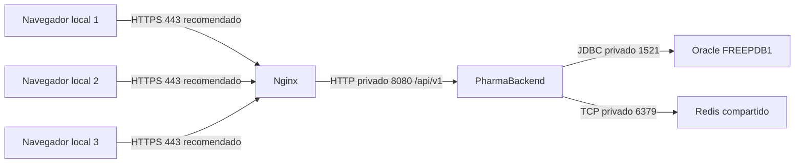

# PharmaBackend

API de farmacia con autenticación JWT, categorías, productos paginados, clientes,
ventas, reportes, caché Redis y observabilidad. Base recibida: Spring Boot 3.3.4,
Java 21 y Oracle. El frontend se publica en el repositorio Fronted.

## Despliegue en producción

### Arquitectura y puertos

En laboratorio: navegador → localhost:8081 → contenedor Nginx:80; API en el
anfitrión:8080; Oracle publicado en localhost:1524 hacia el listener del contenedor
1523; Redis en 127.0.0.1:6379. El navegador nunca consulta Oracle ni Redis.
HTTPS 443 es una recomendación pendiente, no una función ya configurada.

### Variables de entorno

| Variable | Propósito |
|---|---|
| JAVA_HOME | Instalación de Java 21 para construir y ejecutar |
| SPRING_PROFILES_ACTIVE | Seleccionar prod; evita el perfil local en servidores |
| DB_URL | URL JDBC del Oracle de destino |
| DB_USERNAME | Usuario Oracle de la aplicación con permisos mínimos |
| DB_PASSWORD | Contraseña Oracle; solo entorno o gestor de secretos |
| JWT_SECRET | Clave de firma Base64 de al menos 256 bits; diferente por entorno |
| FRONTEND_ORIGINS | Lista exacta de orígenes autorizados, sin comodines |
| REDIS_HOST / REDIS_PORT | Dirección privada y puerto de Redis |
| REDIS_PASSWORD | Autenticación de Redis cuando se configure en producción |

No se publican valores reales. application-local.properties, .local/ y logs/ están
excluidos de Git; application-local.properties también se excluye del JAR. El
perfil local activa dev e importa ese archivo solo desde el sistema de archivos.
Prod no importa esa configuración de desarrollo. No copies esos archivos a un repositorio ni uses la clave de
desarrollo para producción. Las credenciales de las pruebas se leen de un archivo
local ignorado o del entorno, nunca de las capturas o informes.

### Construir y desplegar

1. Configura las variables anteriores en el proceso del servicio. Aprovisiona
   antes el esquema Oracle y sus copias de seguridad; prod usa ddl-auto=validate
   y no ejecuta migraciones automáticamente.
2. Con Java 21: `./mvnw.cmd clean package` en Windows o `./mvnw clean package`
   en Linux. Conserva el JAR, su hash y el commit en una carpeta de versiones.
3. Inicia una sola instancia: `java -jar target/tienda-0.0.1-SNAPSHOT.jar
   --spring.profiles.active=prod`. Comprueba que 8080 esté libre.
4. Desde el frontend, construye y levanta Nginx/Redis con el Compose de deploy.
   No levantes otra instancia Redis en el mismo puerto. La SPA se sirve por el
   proxy y usa /api/v1 relativo.
5. Verifica health público sin detalles, health de admin con db/redis UP, login,
   permisos, un listado y una operación de prueba. Revisa logs sin secretos.

El lanzador scripts/iniciar-backend.ps1 sirve para este laboratorio. Acepta
JAVA_HOME y variables externas; sus valores por defecto describen esta máquina.
En un servidor usa un gestor de procesos y la configuración de su propio entorno.

### Volver a una versión anterior

1. Conserva el JAR anterior y el commit correspondiente antes del despliegue.
2. Si falla health o una verificación funcional, detén solo la instancia nueva,
   ejecuta el JAR anterior con las mismas variables del entorno y verifica health.
3. Restaura también el index y assets de la versión frontend compatible. No borres
   de inmediato los assets con hash que todavía puedan usar pestañas abiertas.
4. Si una futura versión cambia el esquema, prepara antes una migración reversible
   o un plan de restauración de Oracle. No asumas que cambiar el JAR revierte datos.

### Estado de buenas prácticas

| Práctica | Estado | Acción pendiente o alcance |
|---|---|---|
| Rutas y reporte diferidos en SPA | Cumple | Ver README del frontend y mediciones A |
| Presupuestos y hash de bundles | Cumple | Seguir revisando cada build |
| Caché navegador y proxy Nginx | Cumple | Ver tabla B y prueba de despliegue |
| TTL e invalidación de catálogos/ventas | Cumple | Matriz C secuencial verificada; TTL final 10m |
| Caída de Redis y continuidad desde Oracle | Cumple | health informa DOWN; no equivale a alta disponibilidad |
| requestId en logs y errores; visible en SPA | Cumple | Incluye errores de seguridad y negocio |
| Logs sin credenciales, tokens ni DNI completo | Cumple | Auditoría D de esta ejecución; repetir continuamente |
| Actuator con permisos | Cumple | Health público limitado; métricas requieren administrador |
| Perfil prod y secretos externos | Cumple | Operador debe aprovisionar los secretos de cada entorno |
| HTTPS, aislamiento de red y credenciales Redis | Parcial | Configurar certificados, firewall, ACL y red privada |
| Backups Oracle y restauración ensayada | No cumple | Definir retención, destino y simulacro de recuperación |
| Alarmas y continuidad entre tres locales | Parcial | Configurar alertas, monitoreo externo y plan de caída WAN |
| Consistencia bajo concurrencia/múltiples nodos | Parcial | Probar ventas concurrentes y particiones de red |

### Tres recomendaciones priorizadas para los locales

1. **Seguridad del acceso:** HTTPS en Nginx, acceso entre locales por red privada
   o VPN, Oracle y Redis sin exposición pública, mínimos privilegios y rotación
   de secretos. La demostración HTTP local no sustituye estas medidas.
2. **Recuperación de datos:** backups cifrados de Oracle fuera del servidor,
   retención y restauración ensayada; un único Oracle y Redis compartidos para
   mantener catálogos coherentes. Redis es caché, no respaldo de las ventas.
3. **Operación y alertas:** monitoreo de health/latencias/errores desde fuera del
   servidor, alertas si Redis o Oracle caen, logs correlacionados y despliegues por
   versiones con rollback. Medir la conexión de cada local antes de activar precarga.

## Actividad autónoma S13

El informe, las capturas para la presentación y las herramientas de medición
se entregan por separado. El proyecto conserva el backend, sus pruebas y su
lanzador; no contiene el informe PDF ni las capturas académicas.

## Sesión 14: integración y estabilización

Se conserva este proyecto y su base Spring Boot 3.3.4 con Java 21. No se migra a Spring Boot 4 durante la estabilización.

- Oracle de esta práctica: el contenedor existente `oracle-local2`, puerto local 1524 hacia el listener interno 1523, servicio FREEPDB1 y esquema TIENDA. Se corrigió el listener para coincidir con el mapeo de Docker, sin recrear este contenedor. El listener 1522 pertenece a otra instalación.
- `dev` aplica Flyway V4 y valida el esquema. Se conserva el historial previo. Solo si un esquema antiguo carece de historial se admite una línea base V3; no volver a ejecutar V2/V3 sobre tablas existentes. No modificar migraciones aplicadas. En `prod` las migraciones automáticas siguen desactivadas: aplicar V4 antes.
- Productos y Ventas usan paginación SQL y orden estable por id para desempatar. Máximo 100 filas, lista blanca de orden y HTTP 409 para parámetros fuera del rango.
- Contrato existente conservado: `content`, `number`, `size`, `totalElements`, `totalPages`, `last`.
- Auditoría: columnas `creado_por` y `modificado_por`. `GET /api/v1/auditoria` exige `USUARIOS_ADMINISTRAR`. Eventos de negocio después del commit y login fallido en transacción independiente. El detalle no guarda contraseñas, tokens ni DNI.
- `docs/sql/volumen_pruebas.sql` es una carga manual exclusiva de desarrollo, fuera de las migraciones. Sus ventas sin detalle solo sirven para medir listados.
- Pruebas: `./mvnw.cmd test`. JAR: `./mvnw.cmd package`. El lanzador `INICIAR-BACKEND.cmd` usa Java 21 y dev.
